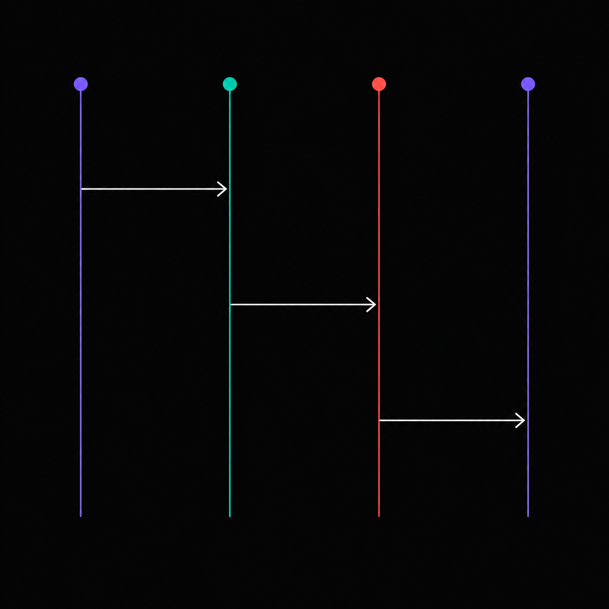

> 中文版 | [English](./README.md)

<p align="center"></p>

<h1 align="center">Turnmeld：Go 多模型 LLM 协议适配库</h1>

Turnmeld 原名 Anthropify。从 v0.3.0 起，安装路径为
`github.com/pejash666/turnmeld`。已有用户请查看
[迁移指南](./docs/guides/migrate-to-turnmeld.md)。

<p align="center"><i>用 Anthropic Messages API 调用 OpenAI、Gemini、Kimi、DeepSeek 等模型，无需代理服务。</i></p>

<p align="center">
<a href="https://pkg.go.dev/github.com/pejash666/turnmeld"></a>
<a href="https://go.dev/"></a>
<a href="./LICENSE"></a>
</p>

## 这是什么？

Turnmeld 是一个开源 Go 库，使用官方
[`anthropic-sdk-go`](https://github.com/anthropics/anthropic-sdk-go)
的请求与响应类型，调用 Anthropic、OpenAI、Gemini、Kimi、GLM、MiniMax、
DeepSeek、AWS Bedrock 和 Azure OpenAI。它在进程内完成协议转换，将 SSE
流式事件、工具调用和思考块统一为 Anthropic Messages API 的形态，无需部署
代理服务器或独立服务。提示词缓存仍有提供商差异，详见[提示词缓存](#prompt-caching)。

应用可以维护同一份 `[]anthropic.MessageParam` 对话历史，通过 `req.Model`
选择已配置的提供商，并始终消费 `anthropic.MessageStreamEventUnion` 流式事件。

[API 文档](https://pkg.go.dev/github.com/pejash666/turnmeld) |
[可运行示例](./examples) |
[OpenAI 与 Gemini 接入指南（英文）](./docs/guides/anthropic-api-with-openai-gemini.md)

### 适用场景

- 为 Go Agent 统一多家 LLM 提供商的消息格式。
- 通过 Anthropic 形态的 API 调用 OpenAI 或 Gemini，无需部署代理服务。
- 在文本对话中切换已配置的模型，复用同一份消息历史。
- 使用一致的流式事件格式消费文本、工具调用和思考块；具体能力仍取决于上游模型。

### 指南

- [在 Go 中用 Anthropic Messages API 调用 OpenAI 与 Gemini（英文）](./docs/guides/anthropic-api-with-openai-gemini.md)：
  提供商配置、流式调用、模型别名和自定义端点。
- [在 Go 中跨模型切换对话（英文）](./docs/guides/switch-llm-providers-in-go.md)：
  在已配置的提供商之间复用文本消息历史。
- [选择嵌入式 LLM 库还是代理服务（英文）](./docs/guides/llm-library-vs-proxy.md)：
  明确协议转换、凭据、限额、重试和运维能力的归属。

## 快速开始

```go
package main

import (
    "context"
    "fmt"
    "os"

    "github.com/anthropics/anthropic-sdk-go"
    tm "github.com/pejash666/turnmeld"
)

func main() {
    client, err := tm.New(
        tm.WithChatCompletion("kimi", tm.OpenAICompatConfig{
            BaseURL: "https://api.moonshot.cn/v1",
            APIKey:  os.Getenv("KIMI_API_KEY"),
        }),
        tm.WithModelRoute("kimi-", tm.Route{
            Provider: tm.ProviderChatCompletions,
            Backend:  "kimi",
        }),
    )
    if err != nil {
        panic(err)
    }

    stream, err := client.CreateMessageStream(context.Background(), anthropic.MessageNewParams{
        Model:     "kimi-k2.6",
        MaxTokens: 1024,
        Messages: []anthropic.MessageParam{
            anthropic.NewUserMessage(anthropic.NewTextBlock("Hello, who are you?")),
        },
    })
    if err != nil {
        panic(err)
    }
    defer stream.Close()

    for stream.Next() {
        fmt.Printf("%+v\n", stream.Current()) // anthropic.MessageStreamEventUnion
    }
    if err := stream.Err(); err != nil {
        panic(err)
    }
}
```

非流式调用使用同一种请求类型，返回 `*anthropic.Message`：

```go
msg, err := client.CreateMessage(ctx, req)
```

## 实战演示

Turnmeld 在应用侧保留 Anthropic 规范形态的对话，由适配器转换为各家上游协议。
[example 03](./examples/03-model-hot-switching) 用四轮文本对话切换三家提供商：
Claude 规划、Kimi 写代码、GLM 翻译、Claude 收尾。全程复用消息历史，每轮选择
`req.Model` 和对应的 token 预算。

<p align="center"></p>

```go
var messages []anthropic.MessageParam
for _, t := range turns {
    messages = append(messages, anthropic.NewUserMessage(anthropic.NewTextBlock(t.question)))
    reply, _ := runTurn(client, t.model, t.maxTokens, messages) // 只 Model 变
    messages = append(messages, anthropic.NewAssistantMessage(anthropic.NewTextBlock(reply)))
}
```

> 完整可运行版本见 [examples/03-model-hot-switching](./examples/03-model-hot-switching)。

提供商注册、模型路由和跨模型兼容性边界的完整说明，见
[在 Go 中跨模型切换对话（英文指南）](./docs/guides/switch-llm-providers-in-go.md)。

## 为什么选 Anthropic 作为标准形态？

各家流式协议差异很大，选什么形态作为 canonical event 会影响下游所有 agent 代码。

- Anthropic 的流是一组语义清晰、有序、有结构边界的事件：`message_start`、
  `content_block_start`、`content_block_delta`、`content_block_stop`、
  `message_delta`、`message_stop`。文本、tool use、thinking 各占独立的 content
  block。
- OpenAI Chat Completions 把所有内容塞进 `choices[*].delta`。工具调用、
  reasoning、refusal 都是边角字段，不同类型的内容之间没有结构性分隔。
- OpenAI Responses 把同一条流拆得很细（`response.output_item.added`、
  `response.content_part.added`、`response.output_text.delta` 等），额外的粒度
  带来记账负担，但并没有让线上形态更易消费。

对一个需要稳定内部事件词汇的 agent 框架来说，Anthropic 的形态在粒度曲线上落在
一个合用的点。Turnmeld 把它作为规范形态，并把所有 provider 都归一化到它。

## 支持的 Provider

| Provider          | 流式  | 非流式                  | Tool use | Thinking         | cache_control |
|-------------------|-------|--------------------------|----------|------------------|---------------|
| Anthropic         | 是    | 原生                     | 是       | 是               | 顶层 + per-block |
| OpenAI Responses  | 是    | drain-and-assemble       | 是       | 是 (reasoning)   | 服务端自动    |
| Azure OpenAI      | 是    | drain-and-assemble       | 是       | 是 (reasoning)   | 服务端自动    |
| Gemini Native     | 是    | drain-and-assemble       | 是       | 是               | 服务端自动    |
| Kimi (Moonshot)   | 是    | drain-and-assemble       | 是       | 是               | 服务端自动    |
| GLM (智谱)        | 是    | drain-and-assemble       | 是       | 视模型而定       | 服务端自动    |
| MiniMax           | 是    | 原生 (anthropic)         | 是       | 是               | 顶层 + per-block |
| AWS Bedrock       | 是    | 原生 (anthropic)         | 是       | 是               | 顶层 + per-block |
| DeepSeek          | 是    | drain-and-assemble       | 是       | 是 (V3.2)        | 服务端自动    |

> **MiniMax** 在 `https://api.minimax.io/anthropic/v1/messages`
> 直接讲 Anthropic 协议，因此可以挂在与真 Claude *同一个* 进程内
> anthropic adapter 上。两个厂商共享一份协议、一份适配器 —— 注册
> 模式（`WithAnthropicCompat("minimax", …)` +
> `WithModelRoute("MiniMax-", …)`）见
> [example 07](./examples/07-anthropic-compat)。

> **AWS Bedrock** 是 Anthropic 协议家族的第三个 backend。Bedrock 分支
> 在 adapter 内部走 `anthropic-sdk-go` 官方 `bedrock` 子包，由它透明
> 处理 SigV4 签名、`/model/{id}/invoke[-with-response-stream]` 路径
> 改写、`anthropic_version: bedrock-2023-05-31` body 注入、
> `anthropic-beta` 头转 `anthropic_beta` body 字段，以及 AWS
> event-stream 二进制帧解码 —— 解出来的事件 JSON 与 Direct/MiniMax
> 字节一致。注册用 `WithAnthropicBedrock`，AWS 那边的模型 ID（或
> inference-profile ARN）通过 `WithModelRoute` + `Route.UpstreamModel`
> 映射。详见下方 [AWS Bedrock 集成](#aws-bedrock-集成) 章节。

> **Azure OpenAI** 是 OpenAI Responses 协议家族的第二个 backend，
> 在 adapter 内部复用 `adapter/openai_responses` 同一份代码——
> canonical `BuildRequest` 和 SSE→Anthropic 事件转换器都字节一致。
> 在网络边界只有两件事不同：URL 拼装（按 `Deployment` 是否填写
> 自动选 deployment-bound `<resource>/openai/deployments/<dep>/responses?api-version=…`
> 还是 deployment-less `<resource>/openai/responses?api-version=…`），
> 以及 auth 头（同时发 `api-key` 和 `Authorization: Bearer`，对
> resource key、Entra/AAD token、APIM 网关都通用）。注册用
> `WithAzureOpenAI`，详见下方 [Azure OpenAI 集成](#azure-openai-集成) 章节。

> Turnmeld 推荐使用 `gemini-3.5-flash`（或任意 Gemini 3.x flash 系列）。
> Adapter 在 `generationConfig.thinkingConfig` 中发送 `thinkingLevel`，
> 2.5 系列会以 HTTP 400 拒绝，因此请使用 3.x 系列。Pro 系列模型
> （`gemini-3-pro-preview`、`gemini-3.1-pro-preview`）需要 Google
> 显式 preview 准入，开箱即用拿不到。

已在 `gemini-3.5-flash`、`gemini-3.1-pro-preview`、`gemini-3-pro-preview`、
`gemini-pro-latest` 上实测 thinking 功能——四个 model 都返回 canonical
thinking blocks，并支持 `thoughtSignature` 跨轮回放（前提：AI Studio
project 已开启 billing）。

只有 Anthropic adapter 直接暴露原生非流式接口。其他 provider 在调用
`CreateMessage` 时，会打开流并由库内部把 content block 组装成最终的
`*anthropic.Message`。

路由基于 `req.Model` 的前缀：

| 前缀                | Provider            |
|---------------------|---------------------|
| `claude-`           | `anthropic`         |
| `gpt-`、`o1-`、`o3-`| `openai_responses`  |
| `gemini-`           | `gemini_native`     |

Kimi / GLM / DeepSeek 等 OpenAI 兼容上游通过 `WithChatCompletion(name, ...)`
注册，并用
`WithModelRoute(prefix, Route{Provider: ProviderChatCompletions, Backend: name})`
路由。

Anthropic 协议兼容的 provider（如 **MiniMax**）直接挂在与真 Claude *同一个*
anthropic adapter 上，通过
`WithAnthropicCompat(name, AnthropicConfig{...})` 注册，再用前缀路由：

```go
tm.WithAnthropicCompat("minimax", tm.AnthropicConfig{
    BaseURL: "https://api.minimax.io/anthropic",
    APIKey:  os.Getenv("MINIMAX_API_KEY"),
})
tm.WithModelRoute("MiniMax-", tm.Route{
    Provider: tm.ProviderAnthropic, Backend: "minimax",
})
```

两个 backend 共享一份 adapter 和一份路由表 —— 完整 demo 见
[example 07](./examples/07-anthropic-compat)。

## AWS Bedrock 集成

AWS Bedrock 是 Anthropic 协议家族的第三个 backend。turnmeld 把所有
Bedrock 专属的脏活（SigV4 请求签名、
`/model/{id}/invoke[-with-response-stream]` URL 改写、
`anthropic_version: bedrock-2023-05-31` body 注入、
`anthropic-beta` 头 → `anthropic_beta` body 字段翻译，以及 AWS
event-stream 二进制帧解码回 Anthropic 标准 SSE 事件）全部委托给
`anthropic-sdk-go` 官方的 `bedrock` 子包。从调用方视角看，Bedrock
backend 与 Direct / MiniMax 字节一致：同样的
`anthropic.MessageNewParams` 请求、同样的 `MessageStreamEventUnion`
流式事件、同样的 `*anthropic.Message` 非流式响应。

注册时给 Bedrock 起任意名字，再用标准的 `WithModelRoute` 路由特定
模型前缀（或精确模型名）到这个 backend。Bedrock 的模型 ID 是按
账户绑定的——形如 `anthropic.claude-opus-4-5-20250929-v1:0`，或者
inference-profile ARN
`arn:aws:bedrock:us-east-1:123456789012:application-inference-profile/abcdef`
——所以推荐写法是 `req.Model` 里只放短名字，让 `Route.UpstreamModel`
在分发时改写。

```go
client, err := tm.New(
    tm.WithAnthropic(tm.AnthropicConfig{
        APIKey: os.Getenv("ANTHROPIC_API_KEY"),
    }),
    tm.WithAnthropicBedrock("bedrock", tm.BedrockConfig{
        AccessKeyID:     os.Getenv("AWS_ACCESS_KEY_ID"),
        SecretAccessKey: os.Getenv("AWS_SECRET_ACCESS_KEY"),
        // SessionToken 可选；只有 STS / SSO 临时密钥才需要
        Region: "us-east-1",
    }),
    tm.WithModelRoute("claude-opus-4-5", tm.Route{
        Provider:      tm.ProviderAnthropic,
        Backend:       "bedrock",
        UpstreamModel: "anthropic.claude-opus-4-5-20250929-v1:0",
    }),
)
if err != nil {
    log.Fatal(err)
}

req := anthropic.MessageNewParams{
    Model:     "claude-opus-4-5", // 标准短名字
    MaxTokens: 1024,
    Messages: []anthropic.MessageParam{
        anthropic.NewUserMessage(anthropic.NewTextBlock("Hello from Bedrock!")),
    },
}
msg, err := client.CreateMessage(ctx, req) // 通过路由表分发到 Bedrock
```

几条注意事项：

- **不内置模型 ID 映射表。** Inference-profile ARN 是按账户/区域
  绑定的；公开的 Bedrock 模型 ID 也每次发版都在变。
  `Route.UpstreamModel` 是唯一权威钩子——映射表放在 *你自己的*
  配置里，才能保证 *你的* 账户上是对的。
- **`anthropic-beta` 标志透明可用。** 通过
  `BedrockConfig.ExtraHeaders["anthropic-beta"] = []string{"…"}` 设置；
  SDK 的 bedrock middleware 会把每个值提到请求 body 的
  `anthropic_beta` 数组里——因为 Bedrock 不接 HTTP 头。
- **Bedrock 上的 `cache_control`。** per-block 和 v0.2.0 顶层两种
  写法都原样转发。Bedrock 目前对顶层形态的支持还在早期；turnmeld
  故意不剥这个字段，所以等上游加上之后你不需要改一行代码。
- **`SessionToken` 可选。** 仅当使用 STS 临时密钥或 AWS SSO 时设置；
  长期 IAM-user key 不需要。设置后 turnmeld 会通过 SigV4 把它
  作为 `X-Amz-Security-Token` 头送出。
- **多 AWS 账户。** 给每个账户注册一个
  `WithAnthropicBedrock("aws-prod", …)`，再把不同模型前缀路由到不同
  名字。turnmeld 故意不在协议 shim 里嵌负载均衡器。

完整设计文档见 `docs/design/v0.2.0-aws-bedrock.md`。

## Azure OpenAI 集成

Azure OpenAI 是 OpenAI Responses 协议家族的第二个 backend。
turnmeld 把 Azure 的请求复用到与 vanilla OpenAI 完全相同的
`adapter/openai_responses` 代码路径上——canonical `BuildRequest`
和 SSE→Anthropic 事件转换器一字未改。只在网络边界做两件事：

- **URL 拼装。** Azure 的 Responses 端点有两种形态：
  `<resource>/openai/responses?api-version=…`（deployment-less）和
  `<resource>/openai/deployments/<deployment>/responses?api-version=…`
  （deployment-bound）。turnmeld 按 `AzureOpenAIConfig.Deployment`
  是否填写自动选。
- **认证头。** Azure 历史上用 `api-key` 头送 resource key；
  Entra/AAD access token 用 `Authorization: Bearer`；APIM 网关
  可能扒掉其中一个。turnmeld 每次请求两个头都发，所以一个
  `APIKey` 字段不管你填的是 resource key 还是 AAD token 都能跑。

注册时给 Azure backend 起任意名字，再用标准的 `WithModelRoute`
路由特定模型前缀（或精确模型名）到这个 backend。推荐写法是每个
Azure deployment 一个 `WithAzureOpenAI(...)`，配合显式
`WithModelRoute` 让调用方继续使用标准的短模型名：

```go
client, err := tm.New(
    tm.WithAzureOpenAI("azure", tm.AzureOpenAIConfig{
        BaseURL:    "https://my-resource.openai.azure.com",
        APIKey:     os.Getenv("AZURE_OPENAI_API_KEY"),
        APIVersion: "2025-03-01-preview",
        Deployment: "gpt-5-deployment",
    }),
    tm.WithModelRoute("gpt-5", tm.Route{
        Provider: tm.ProviderOpenAIResponses,
        Backend:  "azure",
    }),
)
if err != nil {
    log.Fatal(err)
}

req := anthropic.MessageNewParams{
    Model:     "gpt-5", // 标准短名字
    MaxTokens: 1024,
    Messages: []anthropic.MessageParam{
        anthropic.NewUserMessage(anthropic.NewTextBlock("Hello from Azure!")),
    },
}
msg, err := client.CreateMessage(ctx, req) // 路由到 "azure" backend
```

几条注意事项：

- **`APIVersion` 必填。** turnmeld 故意不挑默认值，让 api-version
  升级永远在 source control 里可见。填你 Azure 资源 pin 的版本
  （比如 `2025-03-01-preview`）。
- **Deployment-less 形态。** `Deployment` 留空时，body 的 `model`
  字段决定走哪个 deployment——一个 Azure resource 上挂多个
  deployment、又想用 `Route.UpstreamModel` 路由时很有用。分层
  fallback：`cfg.Deployment > Route.UpstreamModel > req.Model`。
- **Backend 名字命名空间。** `WithOpenAIResponsesCompat("foo", ...)`
  和 `WithAzureOpenAI("foo", ...)` 会撞车。`New()` 会显式报错。
  起不同的名字（比如 `"openai"` 和 `"azure"`）。
- **Azure 上的 `cache_control`。** per-block 和 v0.2.0 顶层两种
  写法都原样转发。Azure 跟 vanilla OpenAI Responses 一样，服务端
  自动 cache。
- **多 deployment。** 给每个 deployment 注册一个
  `WithAzureOpenAI("azure-gpt5", …)`，再把不同模型前缀路由到不同
  名字。turnmeld 故意不在 adapter 里嵌路由逻辑。

完整设计文档见 `docs/design/v0.2.0-azure-responses.md`。

## Prompt caching

Turnmeld 同时支持 Anthropic 的两种 prompt caching 模式：

- **顶层自动模式**（v0.2.0+）。请求上挂一个总开关，由上游自动选最优
  cache 切点，并随对话推进自动前移。

  ```go
  req := anthropic.MessageNewParams{
      Model:     anthropic.Model("claude-opus-4-7"),
      MaxTokens: 1024,
      System:    longSystemPrompt, // 共享的大段 context
      Messages:  conversation,
  }
  tm.SetCacheControl(&req, tm.CacheControl{Type: tm.CacheControlEphemeral})
  msg, err := client.CreateMessage(ctx, req)
  ```

- **per-block 手工 4-tag 模式**。继续通过 SDK 的逐 block
  `SetExtraFields(map[string]any{"cache_control": ...})`（挂在
  `system` / `messages` / `tools` 的 content block 上）。需要把 cache
  切点固定在某个具体 block 时使用。

两种模式可以并存；同时设置时 Anthropic 按
[官方文档](https://platform.claude.com/docs/en/build-with-claude/prompt-caching)
的优先级处理。

### 各 provider 行为矩阵

`SetCacheControl` **只在** anthropic adapter 上被翻译成线上字段（
真 Claude **以及** 通过 `WithAnthropicCompat` 注册的 MiniMax）。其他
backend 上是有据可依的、静默 no-op —— 这些上游服务端本来就自动 cache，
也没有对应的请求字段：

| Provider          | 顶层 `SetCacheControl` 效果                       |
|-------------------|---------------------------------------------------|
| Anthropic         | 发出 `{"cache_control":{"type":"ephemeral"}}`     |
| MiniMax           | 同上（共用 anthropic adapter）                    |
| AWS Bedrock       | 字段原样透传；Bedrock 后端是否生效随其支持演进 —— turnmeld 不会主动剥离 |
| OpenAI Responses  | no-op（>1024 token 时服务端自动 cache）           |
| Azure OpenAI      | no-op（>1024 token 时服务端自动 cache）           |
| Gemini Native     | no-op（Gemini 2.5+ 隐式 cache）                   |
| Kimi (Moonshot)   | no-op（前缀自动 cache）                           |
| GLM (智谱)        | no-op（服务端自动 cache）                         |

也就是说，多 provider 路由层可以无脑调用
`SetCacheControl(&req, ...)` —— Claude 上会真正生效，其他家上自动安静
忽略。

v0.2.0 只发布默认 5 分钟 TTL（`{"type":"ephemeral"}`）。
1 小时延长 TTL 形态在上游需要 Anthropic beta header，会在后续版本暴露。

## Gemini 三种鉴权模式

Gemini adapter 支持三种鉴权方式、两个上游 host。模式通过 `GeminiMode` 显式指
定；`GeminiModeAuto` 保留原有启发式（同时配 project+location 即 Vertex，否则
Studio）。

| Mode    | 适用场景                  | Endpoint                                                     | 鉴权                              |
|---------|---------------------------|--------------------------------------------------------------|-----------------------------------|
| Studio  | 免费层、原型               | `generativelanguage.googleapis.com/v1beta`                   | API key (`AIza...`)，走 `?key=`   |
| Express | 用 API key 调 Vertex      | `aiplatform.googleapis.com/v1/publishers/google`             | API key (`AQ.*`)，走 `?key=`      |
| Vertex  | 生产、GCP 原生             | `aiplatform.googleapis.com/v1/projects/<p>/locations/<l>`    | OAuth2 Bearer token               |

```go
// Studio
tm.WithGemini(tm.GeminiConfig{
    Mode:   tm.GeminiModeStudio,
    APIKey: os.Getenv("GEMINI_API_KEY"),
})
```

```go
// Express（用 API key 调 Vertex）
tm.WithGemini(tm.GeminiConfig{
    Mode:   tm.GeminiModeExpress,
    APIKey: os.Getenv("VERTEX_EXPRESS_KEY"), // AQ.*
})
```

```go
// Vertex（OAuth2）
tm.WithGemini(tm.GeminiConfig{
    Mode:     tm.GeminiModeVertex,
    Project:  os.Getenv("VERTEX_PROJECT"),
    Location: os.Getenv("VERTEX_LOCATION"),
    APIKey:   bearerToken, // gcloud auth print-access-token
})
```

## 安装

```bash
go get github.com/pejash666/turnmeld@v0.3.0
```

需要 Go 1.24 或更高版本。

## 与其他方案的对比

Turnmeld 的边界是有意收窄的：一个把 Anthropic 规范事件和 provider 原生协
议互相转换的 Go 库。它不是代理服务、不是路由层、不是多租户网关，仓库里没有
`cmd/`、没有 YAML、没有 daemon。

如果你需要一个开箱即用的托管代理，带鉴权、限流、计费和多租户，LiteLLM 是更完
整的方案，并以 Python 为主。如果你需要一个 Go 原生、嵌进 agent 里用的库，要
求一等公民级别的流式、tool use 支持，并且事件形态对齐 Anthropic 规范，那
Turnmeld 就是为此而生。

## 状态

> **alpha**。API 可能调整。四条 adapter 链路都跑过真实 API 测试（25 个 E2E 测
> 试，0 失败，覆盖 Anthropic / OpenAI / Gemini / Kimi / GLM / DeepSeek）。生
> 产使用请固定到具体 commit。

## 测试

单元测试基于 fixture，不会触网络：

```bash
go test ./...
```

真实网络的 smoke 测试位于 `e2e/`，由 build tag 隔离：

```bash
cp .env.e2e.example .env.e2e   # 只填你手上有 key 的 provider
make test-e2e                  # 加载 .env.e2e 并运行 `go test -tags=e2e ./e2e/...`
```

未配置 API key 的 provider 会自动跳过。具体矩阵见 `e2e/README.md`。`.env.e2e`
已被 git 忽略，仓库里只追踪 `.env.e2e.example`。

## 贡献

欢迎 issue 和 pull request。发 PR 前请确认：

- `go test ./...` 通过。
- 改动了 adapter 行为时，请在 `e2e/` 增加对应 E2E 测试，并用真实 key 跑过
  `make test-e2e`。
- 公共 API 尽量复用 `github.com/anthropics/anthropic-sdk-go` 的类型别名，不要
  另起一套请求/响应结构。

## 许可证

MIT，详见 [LICENSE](./LICENSE)。
